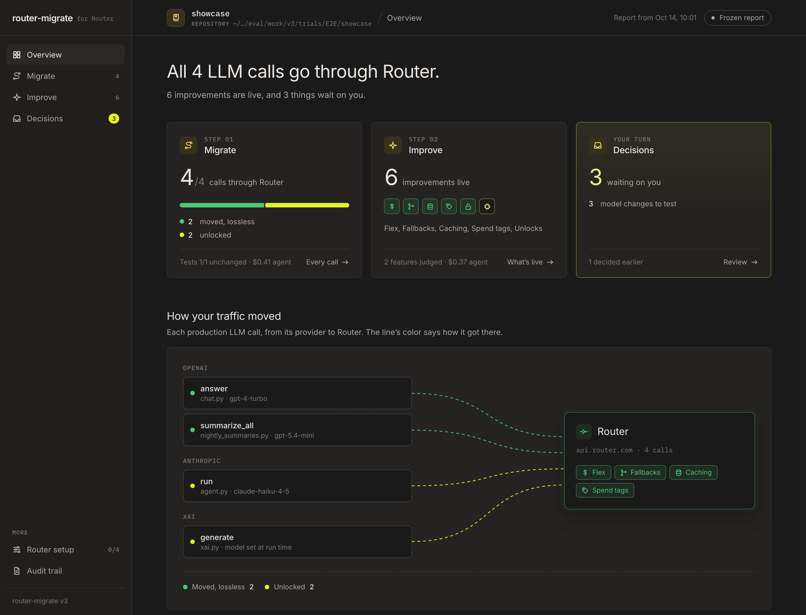
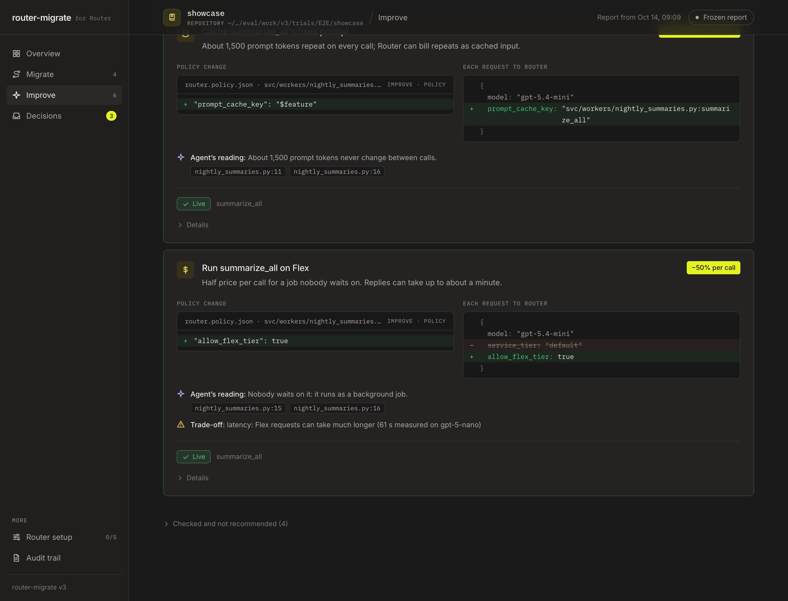

# router-migrate

Move a codebase's production LLM calls onto [Ramp's Router](https://router.com) with one command, without breaking anything.

```bash
router-migrate run . --test-cmd "pytest -q" --agent claude
```

That command scans the repo, wraps every OpenAI / Anthropic client that should go through Router, has a coding agent settle
the calls rules can't, gates the result on your tests, and then opens a local dashboard. The dashboard shows every call it
moved, the Router improvements available on top (Flex, fallbacks, caching, spend tags), and what still needs your decision.

Nothing changes at runtime until `RAMP_ROUTER_API_KEY` is set. Requests Router can't serve exactly still go to the original
provider, unchanged.

> **Status:** working MVP, under active development. Python and TS/JS; OpenAI, Anthropic, LangChain, Vercel AI SDK,
> LlamaIndex and LiteLLM. The evaluation on open-source repos is still being finalized; results will be published here
> once it is.


<sub>The dashboard after a full run on a small synthetic app where every lever applies ([eval/v3/e2e/showcase](eval/v3/e2e/showcase)).</sub>

## How a migration runs

The rule throughout: **tools compute facts, the agent makes judgments with evidence, a codemod makes the edits, and a human
decides trade-offs.** Nothing the agent says counts until a tool confirms it.

1. **Floor (deterministic).** Scan every LLM call site, classify each one by rules, and wrap every client the rules are sure
   about with a one-line call into a small vendored runtime.
2. **Worklist.** Everything the rules couldn't settle, plus lines that look like LLM usage that no scanned site explains.
3. **Agent loop.** For each item the agent reads the code and config, asks the tool whether the call routes (`check`), edits
   only through the codemod (`wrap`), and records a decision with file:line evidence (`claim`).
4. **Gate.** `finish` checks parse, scope, typecheck, tests against the baseline, and a Router-on test run against
   **router-sim**, a local Router stand-in. The agent isn't done until it passes; after 3 failures its edits are reverted to
   the floor.
5. **Improve.** The agent judges each migrated feature's latency class, task and cacheability. Tool rules plus Router's
   catalog turn those judgments into cards: Flex for background jobs, fallback models, prompt cache keys, spend tags, unlocks
   for other vendors' endpoints, and model recommendations (never applied automatically).
6. **Dashboard.** Approve cards, click Apply, and run `finish` again. Approved cards compile into a policy file the runtime
   reads.
7. **In production, the runtime decides per request.** If Router can serve the request exactly, it goes to Router. Otherwise
   it goes to the provider byte-for-byte unchanged. If Router refuses before generating anything, the request is retried on
   the provider once.

[METHODOLOGY.md](METHODOLOGY.md) walks a repo through every stage: who decides, what's inspected, and what can go wrong.

### The dashboard

A local page (127.0.0.1, session token) styled after Router's console, with one job per page:

| Page | What it's for |
|---|---|
| **Overview** | Where the repo stands in one sentence, and how each call reached Router |
| **Migrate** | Every LLM call: moved losslessly, moved by the agent, unlocked, needs you, or left in place, with the exact line that changed |
| **Improve** | Each improvement as its code or policy change next to its effect on the request body, with the agent's reading and its evidence |
| **Decisions** | Only what waits on you; approve, dismiss, then Apply |
| **Router setup** | The account settings that finish the rollout, with this repo's numbers (including a spend-cap calculator) |
| **Audit trail** | Every decision, who made it, why, and the lines it rests on |



## Install

Requires Python 3.9+ and Node 18+ (Node is only needed for TS/JS repos). The agent step uses the `claude` CLI.

```bash
git clone https://github.com/SanjithSambath/router-migrate && cd router-migrate
make setup                                # .venv (libcst, httpx, SDKs for verify) + node_modules (ts-morph), all local
export PATH="$PWD/bin:$PATH"              # bin/router-migrate
router-migrate --help
```

## Usage

```bash
cd your-repo
router-migrate run . --test-cmd "<tests>" --agent claude   # floor -> agent -> gate -> Improve -> dashboard
export RAMP_ROUTER_API_KEY=...                              # turn routing on; ROUTER_MIGRATE_DISABLE=1 turns it off
```

Prefer your own coding agent? `router-migrate run .` applies the floor and writes the worklist, and the
[router-migrate skill](.claude/skills/router-migrate/SKILL.md) plus [the prompt](router_migrate/prompts/migrate.md) give the
agent the loop below.

| Command | What it does |
|---|---|
| `run PATH [--agent claude]` | Floor, ledger and worklist; with `--agent`, the agent loop, the gate, Improve and the dashboard |
| `check FILE:LINE` | Does the runtime reroute this call as the code stands? `routes`, `wont_route`, or `routes_if` |
| `wrap FILE:LINE` | The deterministic one-line wrap at any client construction (factories included) |
| `claim FILE:LINE OUTCOME --why … --evidence FILE:LINE` | Record a decision: migrated, kept, flagged, handoff, needs_human, not_a_site |
| `finish PATH` | The gate; `--hook` for a coding agent's Stop hook |
| `improve PATH [--agent claude]` | Improve cards from the migrated code and the agent's judgments |
| `judge FILE:LINE KIND VALUE` | Record a judgment (latency, task, cacheable) with `--why` and `--evidence` |
| `decide ID approve\|dismiss\|postpone\|shadow-first` | Decide a card from the command line |
| `apply PATH --decisions` | Compile approved cards into the policy file and apply approved unlock edits |
| `status PATH` | Effective policy per feature; exit 1 if the compiled policy is stale |
| `scan` / `plan --dry-run` / `apply` / `verify` / `report` | The deterministic pass, one stage at a time |

`verify . --live --budget 0.10` replays migrated requests against the real Router with a dollar cap.

Typical diff (openai/swarm):

```diff
+try:  # router-migrate: route LLM traffic through Ramp's Router when RAMP_ROUTER_API_KEY is set
+    from .router_runtime import wrap_openai as _router_wrap_openai
+except ImportError:  # router-migrate: module executed as a script
+    try:
+        from router_runtime import wrap_openai as _router_wrap_openai
+    except ImportError:  # router-migrate: runtime not importable from here; this module keeps its original behavior
+        _router_wrap_openai = lambda c, *a, **k: c  # noqa: E731
 ...
-            client = OpenAI()
+            client = _router_wrap_openai(OpenAI())
```

TS/JS:

```diff
-const client = new OpenAI({ apiKey });
+const client = new OpenAI({ apiKey, ...routerOptions() });
```

## The runtime

Existing code keeps calling `chat.completions.create` and reading `.choices[0].message`. The vendored runtime, one readable
file, translates those calls to Router's API and translates replies and streams back.

```
your code ── client.chat.completions.create(...) ──► OpenAI SDK ──► router transport (vendored)
                                                                    ├─ servable? ─► Router POST /v1/responses ─► translated back to a ChatCompletion / chunk stream
                                                                    └─ otherwise ─► original provider, request untouched
```

- **Inert until you opt in.** With no `RAMP_ROUTER_API_KEY`, every patched line returns the original client, so tests, mocks
  and cassettes see exactly the same requests. `ROUTER_MIGRATE_DISABLE=1` is the kill switch.
- **Never a hard failure.** Embeddings, images, audio, `n>1`, logprobs, `seed`, models outside the catalog, provider-side
  vector stores and other vendors' base URLs stay on the provider. If Router refuses before generating anything (unknown
  parameter, model not available to the key, 501), the original request is sent to the provider once.
- **Your transport settings still apply.** The runtime installs under the client's own transport and proxy mounts, so
  certificates, `proxy=`, `HTTP(S)_PROXY`, headers, hooks and pools all keep working.

| Surface | What happens |
|---|---|
| OpenAI `chat.completions` (sync, async, stream, tools, `parse`, legacy `functions`) | translated to `/v1/responses` and back, including SSE |
| OpenAI `responses` | sent to Router minus `store` (Router rejects `store:true`); `previous_response_id` chains that started on Router continue with the history inline |
| Anthropic `messages` (create, stream, `count_tokens`) | sent to Router `/v1/messages`; model id mapped |
| LangChain `ChatOpenAI` / `ChatAnthropic` | the SDK clients LangChain built are wrapped in place |
| LlamaIndex, LiteLLM | `http_client` injection, or install hook |
| Vercel AI SDK `createOpenAI` / `createAnthropic` / default `openai` provider | `fetch: routerFetch()` |
| embeddings, images, audio, files, assistants, vector stores, legacy completions | **kept** on the provider (Router has no such endpoint; measured 404) |
| Azure, Bedrock, Vertex, Groq/OpenRouter/DeepSeek/Ollama base URLs | **kept** (an approved unlock card can move an OpenAI-compatible endpoint whose model Router serves exactly) |

### Rules the runtime applies (each measured against the live API)

| Rule | Why |
|---|---|
| `max_tokens` -> `max_output_tokens`; values below 16 stay on the provider | Responses rejects `max_tokens`; its minimum is 16 |
| `stop` stripped for OpenAI models and emulated client-side (works across stream chunks) | Router returns 501 for `stop` on OpenAI models |
| `temperature` / `top_p` dropped where the catalog says unsupported | 400 otherwise |
| tools sent as flat Responses tools with explicit `strict: false` | Responses defaults to strict schemas |
| `store` removed; Router-started chains replayed inline; `include: reasoning.encrypted_content` for OpenAI reasoning models | Router keeps no server state |
| `prompt_cache_key` added for Claude | Claude via Responses doesn't cache without it |
| `service_tier: "default"` unless the caller or an approved Flex card sets one | flex is the account default and adds latency |
| dated model ids mapped only where Router itself reports the equivalence | dated ids 404; undated aliases can be newer snapshots |
| `metadata.feature = "<file>:<function>"` | per-feature cost attribution with no call-site edits |

## Limits

- **Ready:** the runtime's safety properties (inert by default, kill switch, per-request fallback), the codemod, the scope and
  revert discipline, and the audit trail.
- **MVP:** the dashboard is local and single-user. Improve policy applies to Responses-surface calls; `/v1/messages` gets no
  policy yet. TS unlock codemods aren't built.
- **Not yet proven:** translated requests on code paths the repo's tests don't exercise, the agent's run-to-run variance, and very
  large monorepos.
- Models outside Router's catalog stay on their provider; substituting a model is a product decision, so it's only ever a card.
- `previous_response_id` chains that start on Router live in process memory (last 256), so a turn that lands on another worker
  gets a clear error. Clients that use stateful Responses features are kept off Router for this reason.
- `metadata.feature` and `prompt_cache_key` send a repo-relative `file:function` name to Router; `ROUTER_MIGRATE_FEATURE_TAG=off`
  disables them.

## Docs

- [METHODOLOGY.md](METHODOLOGY.md): how a migration actually happens, stage by stage. Start here.
- [SYSTEM_DESIGN.md](SYSTEM_DESIGN.md): the system top to bottom, with one real call traced through every stage.
- [SPEC_V3.md](SPEC_V3.md): the design of the agent-native loop. [DECISIONS.md](DECISIONS.md): why things are the way they are.
- [ARCHITECTURE.md](ARCHITECTURE.md), [AGENTS.md](AGENTS.md).

## Development

```bash
make test        # runtime vs router-sim through real SDKs, codemod golden fixtures, planner, dashboard
make compat      # runtime smoke under every eval env (openai 2.x/httpx and 3.x/httpx2, anthropic)
make eval        # run the eval harness on the pinned repo set
make sim         # router-sim on :8787
```
