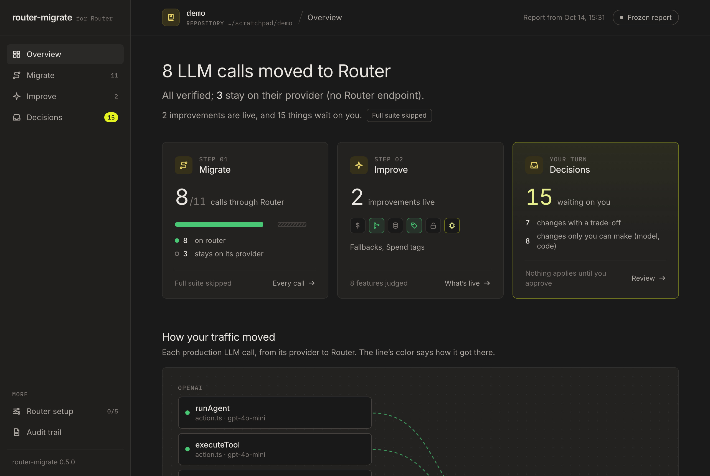

# router-migrate

Move a codebase's production LLM traffic onto [Ramp's Router](https://router.com), and keep everything it did before.

router-migrate is a Claude Code skill plus a small CLI. Your coding agent does the work: it migrates the code, reviews the
system for what Router makes possible, builds the improvements worth building, and later applies what you approve and
undoes what you reject. The CLI keeps it honest: facts it can't guess (does Router serve this request?), a sandbox, live
Router checks with a spend-capped key, and an outside check it can't influence. A vendored runtime then decides per
request in production: Router when Router can serve it, the original provider otherwise. Without `RAMP_ROUTER_API_KEY`
it does nothing.

> **Status:** working MVP (v6, agent-forward), under active development. Python and TS/JS; OpenAI, Anthropic, LangChain,
> Vercel AI SDK, LlamaIndex and LiteLLM. The evaluation on open-source repos is still being finalized; results will be
> published here once it is. First v6 end-to-end runs: [eval/v6/RESULTS.md](eval/v6/RESULTS.md).

## Quickstart

### Install

**As a Claude Code plugin** (works in any repo, any model). In Claude Code:

```
/plugin marketplace add <path-to-this-checkout or owner/repo>
/plugin install router-migrate@router-migrate
```

The plugin puts `router-migrate` on the session's PATH; its first run installs its two Python dependencies (libcst, httpx)
into a cached venv, and the TS codemod's node modules when npm is available.

**From a checkout** (CLI on your PATH, skill available as `/router-migrate`):

```bash
git clone <this repo> router-migrate && cd router-migrate
make setup                                                  # local .venv and node_modules (or: pip install -e .)
export PATH="$PWD/bin:$PATH"
ln -s "$PWD/skills/router-migrate" ~/.claude/skills/router-migrate
```

**Requirements:** a git repo to migrate; Python 3.9+; Node 18+ for TS/JS repos.

### Optional: a migration key

Live checks work best with a Router key. Use a dedicated key with a spend cap, separate from production:

```bash
mkdir -p ~/.config/router-migrate && (umask 077; printf '%s' "$KEY" > ~/.config/router-migrate/key)
```

With it, the agent sends real requests to confirm what Router accepts and reads the live catalog and prices. Without
it everything still works against the offline simulator, and every card says which kind of evidence it has. The key is only injected into commands the tool runs for the agent; it is never printed or stored.

### Migrate and improve

**In Claude Code**, from the repo you want to migrate (clean working tree): `/router-migrate` (plugin:
`/router-migrate:router-migrate`), or just say "migrate this repo to Router". The session you are in is the agent, on
whatever model it runs:

1. `router-migrate start .` creates the branch `router-migrate/migration`, starts the baseline tests in the background,
   and prints the instructions, this repo's context and a map of every LLM call it sees.
2. The session serves each call through Router however is best (wrapping, porting to another API, SDK or model,
   restructuring), commits one commit per decision, reviews the system for improvements, builds the worthwhile ones as
   branches `router-migrate/improve/<name>`, and writes `.router-migrate/MIGRATION.json`.
3. `router-migrate finish .` runs the outside check on the migration and on every improvement branch, and opens the
   dashboard.

**Headless** (CI, evals): the same prompt and the same `start`/`finish` code around a `claude -p` session:

```bash
router-migrate run . --agent claude [--model <model>]
```

**Other agents** (Codex and others): follow [AGENTS.md](AGENTS.md).

### Review, apply, undo, ship

On the dashboard, approve, dismiss or postpone improvements and mark any change for undo; then press Apply. Apply hands
your whole list to an agent session, which decides how to carry it out (merge order, conflicts, partial reverts) and
explains anything it declined. In Claude Code that's `/router-migrate apply`; with the CLI logged in, the dashboard
starts it for you. The outside check runs again afterwards. Then:

```bash
git checkout main && git merge router-migrate/migration   # when you're happy with the branch
export RAMP_ROUTER_API_KEY=...                            # traffic Router can serve goes to Router; the rest is unchanged
```

`ROUTER_MIGRATE_DISABLE=1` turns it off again without a deploy.

## What you get



- **A branch you review**, `router-migrate/migration`: one commit per decision, plus the vendored runtime
  (`router_runtime.py` / `routerRuntime.ts`). Nothing is merged into your branches by the tool.
- **A CTO's review of the whole product on Router**, ranked by value at three levels (quick win, change, rework):
  anything from a cache key or a priority tier to a different model, a step made deterministic or with no LLM at all,
  shadow models, Jev or Switchyard, or a redesign of how the product uses models. What the agent is sure of is built and
  checked on a branch; the rest is proposed, and an apply session builds it once you approve. Decisions only you can
  make (a model change, a setting on app.router.com) are approvable too. Each says what it gains, what it loses, the
  price change and exactly what was checked.
- **A dashboard** (`REPORT.html` and a live local page) where everything is the same kind of card: Overview (traffic on
  Router, behaviour check, what waits on you, the agent's summary), Calls, Changes, Your queue (one Apply), History (each
  apply session's log) and Router setup.
- **An audit trail**: git history plus `.router-migrate/` (excluded from git).

## How it works

```
 start (code)       clean tree · branch router-migrate/migration · baseline tests in the background · live catalog
     │              with a key · the scanner's map of LLM calls (a hint)
 agent              migrate however is best · label features · live-check with the key · one commit per decision
     │              review the system · build worthwhile improvements as branches · notes for the rest · MIGRATION.json
 finish (code)      the outside check on the migration and every improvement branch: parse · typecheck and tests with
     │              Router on vs the baseline · existing tests unchanged · Router accepts the requests · route truth;
     │              deletions, dependency changes, provider-key removals, runtime edits flagged for you · never reverts
 you                approve · dismiss · postpone · undo, on the dashboard
     │
 agent (apply)      gets the whole list, decides how to carry it out, commits each result, explains what it declined
     │
 check (code)       the outside check again; the dashboard shows the result and the session's log
```

In production, per request:

```
your code ─▶ OpenAI / Anthropic SDK ─▶ router runtime ─┬─ Router can serve it ─▶ Router (/v1/responses, /v1/messages)
                                                       └─ otherwise ─────────▶ original provider, unchanged
```

Chat Completions calls are translated to Router's Responses API and back, streams included. Router's levers and what
was measured about each live in [router_migrate/data/ROUTER.md](router_migrate/data/ROUTER.md). Details:
[docs/ARCHITECTURE.md](docs/ARCHITECTURE.md).

## Who decides what

| | Decides |
|---|---|
| **The agent** | Everything that takes understanding: which provider, API, SDK and model serve each call; which trade-offs to take and what they lose; which improvements are worth building; how to apply and undo what you ask |
| **Code** | Facts (does Router accept this, catalog and prices), the outside check, the runtime's per-request routing |
| **You** | Every improvement, every undo, anything flagged (deleted files, dependency changes, capability removals); merging the branch; going live |

## Safety model

- **Inert by default.** Without `RAMP_ROUTER_API_KEY` in the app's environment, every wrapped client behaves exactly as
  before.
- **Kill switch.** `ROUTER_MIGRATE_DISABLE=1` sends everything to the provider.
- **Your work is untouched.** `start` refuses a dirty working tree; the migration and every improvement live on their
  own branches.
- **Outcomes, not edit bans.** The agent may change dependencies, delete files or port code; the outside check judges
  the result (tests and typecheck vs the baseline, existing tests unchanged, valid Router requests), and anything that
  could remove a capability is flagged for you.
- **One outside check.** It re-derives everything from the tree and the simulator, and trusts nothing the agent wrote.
- **Truthful reporting.** A call is "verified" only when a valid Router request from it was seen; every card says what
  was checked and against what.
- **Everything reversible.** Every decision is a commit; Undo is a request the agent carries out and the check verifies.
- **The migration key stays secret.** It is injected only into commands the tool runs for the agent, scrubbed from
  output, and never stored in the repo.

## Limits

- Python and TS/JS. Calls the scanner can't see depend on the agent finding them; the outside check reports what it
  can't verify as unverified.
- Router serves `/v1/responses`, `/v1/messages` and `/v1/models`. Embeddings, images, audio and files stay on the
  provider (or the agent ports them, if it judges that worth it).
- Router keeps no server-side state. Code that relies on stored responses or conversations stays on the provider.
- One Router key per deployment. Per-user keys stay on the provider unless the app also has an operator key.
- Answer quality after a model change isn't measured: the card says answers will differ (the agent may attach a few
  samples through both models when a key is available).
- Evaluated with one run per repository. See [docs/EVAL.md](docs/EVAL.md#limitations).

## Repo layout

```
router_migrate/          the CLI
  runtime/               the vendored runtime (Python, TS)
  sim/                   router-sim, a local Router stand-in
  dashboard/             REPORT.html and the live page
  prompts/               the agent's instructions
  ts/                    TypeScript scanner and codemods
  data/                  catalog and the Router fact sheet (ROUTER.md)
  schemas/               state-file contracts (V6_CONTRACTS.md)
skills/router-migrate/   the Claude Code skill (also linked from .claude/skills/)
.claude-plugin/          Claude Code plugin + marketplace manifest
bin/router-migrate       entry point (bootstraps its own venv when installed as a plugin)
eval/                    eval harness, repo sets, results (RESULTS.md)
tests/                   runtime vs router-sim, codemods, harness end to end, dashboard
docs/                    architecture, methodology, eval, plans
archive/                 earlier specs, decisions, research and eval material (v1–v4), indexed in archive/README.md
```

## Docs

- [WRITEUP.md](WRITEUP.md): one page on the result.
- [docs/ARCHITECTURE.md](docs/ARCHITECTURE.md): components, state files, contracts, the per-request flow, the CLI.
- [docs/METHODOLOGY.md](docs/METHODOLOGY.md): first principles, who decides what, prior art, v1 to v6.
- [docs/EVAL.md](docs/EVAL.md): method, results, limitations, how to reproduce.
- [router_migrate/data/ROUTER.md](router_migrate/data/ROUTER.md): Router's levers and measured facts.
- [docs/plans/v6-agent-first.md](docs/plans/v6-agent-first.md): the v6 design.
- [AGENTS.md](AGENTS.md): instructions for coding agents.
- [archive/docs/](archive/docs/): v1–v4 specs, decisions and system design.

## Development

```bash
make test        # runtime vs router-sim through real SDKs, codemod fixtures, planner, parsers
make compat      # runtime smoke under every SDK version in the eval envs
make sim         # router-sim on :8787
```
