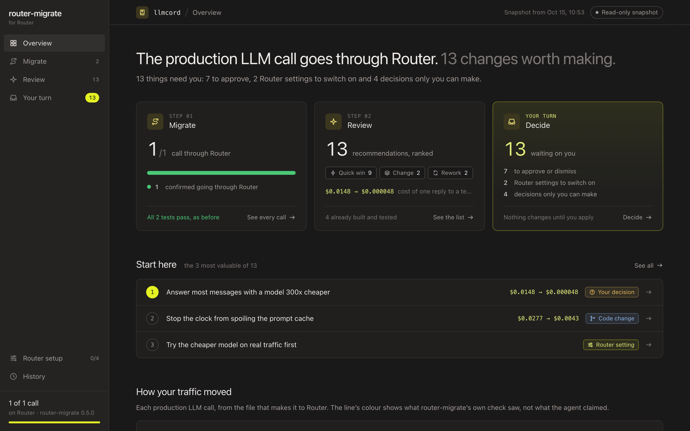
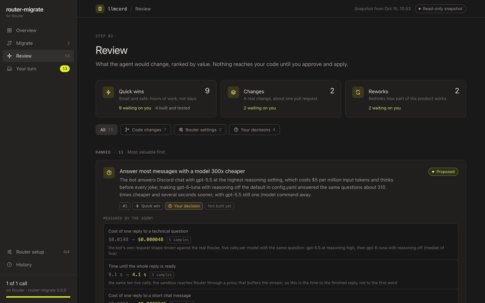
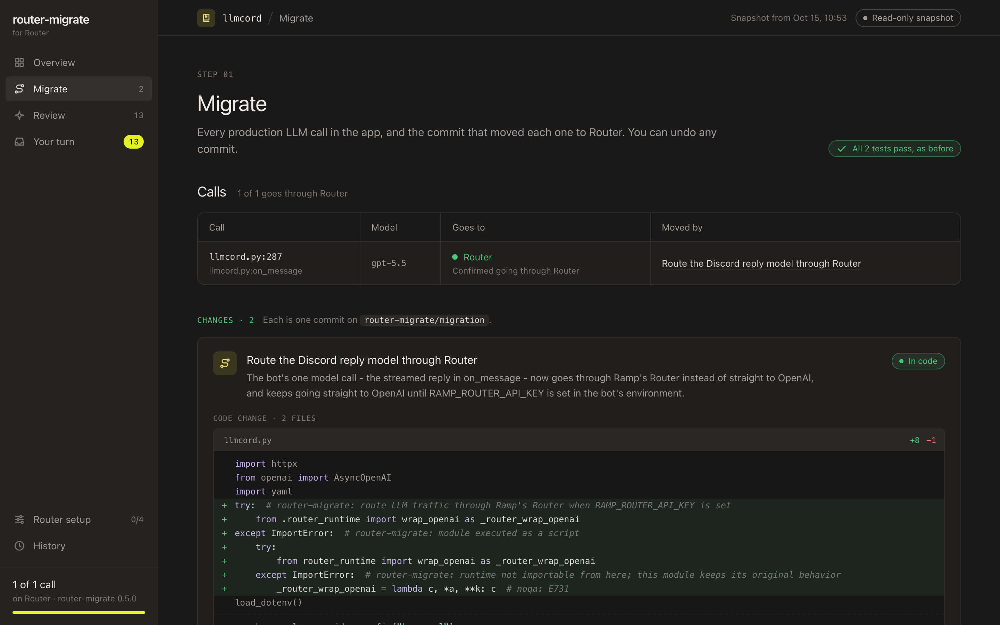
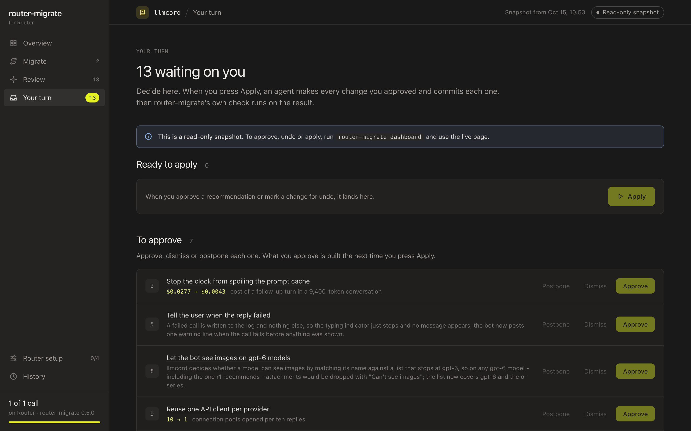

# router-migrate

**Move a codebase's LLM traffic onto [Ramp's Router](https://router.com) without breaking it, then get a CTO-level plan
for what the product should become on Router.**

router-migrate is a Claude Code skill and a small CLI. Your coding agent does the work in two halves:

1. **The migration (the gate).** It moves every production LLM call it can onto Router and proves the app still behaves
   the same: same tests, same typecheck, requests Router actually accepts.
2. **The review (the product).** It then reads the whole product the way a CTO who knows Router would, measures what
   matters on real Router, and ranks what to change: from a one-line cache fix to removing an LLM call entirely.

You decide on a dashboard. An agent builds what you approve and undoes what you reject, and an outside check the agent
can't influence verifies every step.



---

## What a run gives you

**A ranked list of what to change, with numbers measured on real Router.** Each recommendation says how big it is
(quick win, change, or rework), who carries it out (code, a Router setting, or your call), what it gains, what it could
make worse, and what was measured, with the sample size.



Recommendations from real runs, in the agent's words:

- *Answer per-document financials without an inner agent* (sec-insights): each document had its own agent whose only
  tool returns the same data whatever is asked; replacing it with one direct call halves the requests per document.
- *Answer most messages with a model 300x cheaper* (llmcord): measured on real Router over 5 samples, a reply to a
  technical question cost $0.000048 instead of $0.0148 and was ready in 4.1 s instead of 9.1 s. Filed as your decision,
  with shadow models proposed to confirm quality on real traffic first.
- *Stop the clock from spoiling the prompt cache* (llmcord): the current time sat at the top of the prompt, so no two
  requests shared a cacheable start; moving it cut a follow-up turn in a long conversation from $0.0277 to $0.0043.
- *Collapse the two-level agent so answers stream sooner* (sec-insights): a rework, proposed rather than built; after
  approval an apply session built it and the outside check passed.

**A migration branch you review**, `router-migrate/migration`, one commit per decision, plus a small vendored runtime.
The Migrate page shows each change next to what was checked.



**One place to decide.** Approve, dismiss or postpone recommendations; mark Router settings done once you've switched
them on in the console; mark any change for undo. Apply hands your whole list to an agent session.



## Results

| Question | Evidence |
|---|---|
| Does traffic really move without breaking anything? | On 10 open-source repos (64 movable production calls): 0 repos broken, 0 wrong moves, 0 destructive edits; held-out repos: 23 of 45 movable calls moved. Router's public docs prompt broke a repo and made 54 destructive edits. [EVAL.md](docs/EVAL.md) |
| Is the review worth acting on? | Blind head-to-head judging: the current 15-line prompt beat the previous ~150-line one 5-0 on five repos never used for tuning, under both rubrics. [EVOLUTION.md](docs/EVOLUTION.md) |
| Does approve-then-build work? | An approved, never-built rework was built by an apply session and passed the outside check. |
| Are the numbers real? | Measured through Router with a spend-capped key; e.g. one llmcord run made 47 live requests. Every number shows its sample size. |

Every run in these experiments passed the outside check. Caveats: one run per arm and repo, judged by a Claude reviewer;
see [Limits](#limits).

## Quickstart

**Requirements:** a git repository with a clean working tree, Python 3.9+, and Node 18+ for TS/JS repos.

### 1. Install

As a Claude Code plugin (any repo, any model):

```
/plugin marketplace add <path-to-this-checkout or owner/repo>
/plugin install router-migrate@router-migrate
```

Or from a checkout:

```bash
git clone <this repo> router-migrate && cd router-migrate
make setup
export PATH="$PWD/bin:$PATH"
ln -s "$PWD/skills/router-migrate" ~/.claude/skills/router-migrate
```

### 2. Add a migration key (recommended)

A dedicated Router key with a spend cap, separate from production. With it, the agent measures cost, caching and
latency on real Router; without it, everything still runs against a local copy of Router's rules, and the dashboard says
nothing was measured.

```bash
mkdir -p ~/.config/router-migrate && (umask 077; printf '%s' "$KEY" > ~/.config/router-migrate/key)
```

The key is only injected into the commands the tool runs for the agent. It is never printed, logged or committed.

### 3. Run it

In Claude Code, from the repository you want to migrate: `/router-migrate` (or say "migrate this repo to Router"). Your
session is the agent:

1. `router-migrate start .` creates the branch, starts the baseline tests and prints the instructions with a map of
   every LLM call it found.
2. The agent migrates, reviews, measures, commits, and writes `.router-migrate/MIGRATION.json`.
3. `router-migrate finish .` runs the outside check and opens the dashboard.

Headless (CI, evals) runs the same prompt and the same checks around a `claude -p` session:

```bash
router-migrate run . --agent claude
```

### 4. Decide, apply, ship

Decide on the dashboard, then press Apply (in Claude Code: `/router-migrate apply`). When you're happy with the branch:

```bash
git checkout main && git merge router-migrate/migration
export RAMP_ROUTER_API_KEY=...        # requests Router can serve go to Router; everything else is unchanged
```

`ROUTER_MIGRATE_DISABLE=1` turns it off again without a deploy.

## How it works

```
 start          code    clean tree · branch · baseline tests · live catalog · map of LLM calls
 migrate        agent   move each call however is best · one commit per decision · check on real Router
 review         agent   read the product as its CTO · measure · rank · build what it's sure of, propose the rest
 finish         code    the outside check: tests and typecheck vs the baseline, Router accepts the requests,
                        which calls really reach Router · never reverts anything
 decide         you     approve · dismiss · postpone · mark Router settings done · undo
 apply          agent   carries out your whole list, explains anything it declined
 check          code    the outside check again
```

In production, per request:

```
your code ─▶ OpenAI / Anthropic SDK ─▶ router runtime ─┬─ Router can serve it ─▶ Router
                                                       └─ otherwise ─────────▶ the original provider, unchanged
```

| Who | Decides |
|---|---|
| **The agent** | Everything that takes understanding: how each call should reach Router, what to change about the product, how to carry out what you approve. |
| **Code** | Facts (does Router accept this request? what does it cost?), the outside check, and the runtime's per-request routing. |
| **You** | Every recommendation, every product call, Router account settings, every undo, merging, going live. |

Details: [ARCHITECTURE.md](docs/ARCHITECTURE.md).

## Safety

- **Inert by default.** Without `RAMP_ROUTER_API_KEY` in the app's environment, nothing changes at runtime.
- **Always a way back.** `ROUTER_MIGRATE_DISABLE=1` sends everything to the original provider. Every decision is a
  commit, and every commit can be undone from the dashboard.
- **Your branches are untouched.** Work happens on `router-migrate/*` branches; nothing is merged or pushed for you.
- **Judged on outcomes.** The agent may change dependencies or port code. The outside check judges the result, and
  anything that could remove a capability is flagged for you.
- **Honest reporting.** A call counts as on Router only when a request from it was accepted. Every card says what was
  checked and how.

## How we got here

Seven versions, each testing one hypothesis. Rules that make judgment calls overfit (v1–v2). Tools that compute facts
removed wrong moves where prompts couldn't (v3). Proving every move was slow; one outside check kept the safety at a
third of the time (v4–D3). Letting the agent own every judgment made the review possible (v5–v6). Then a series of
blind experiments showed that **cutting procedure helps, cutting facts or tools hurts, and widening the mandate turns a
migration tool into a product review** (v7).

The full story, with every hypothesis and its evidence: **[docs/EVOLUTION.md](docs/EVOLUTION.md)**.

## Limits

- Python and TS/JS; OpenAI, Anthropic, LangChain, LlamaIndex, LiteLLM and the Vercel AI SDK.
- Router serves `/v1/responses`, `/v1/messages` and `/v1/models`. Embeddings, images, audio and files stay on the
  provider unless the agent ports them.
- Answer quality after a model change isn't measured; such changes are filed as your call, with shadow models proposed.
- Measured numbers come from small samples (usually 1 to 5 requests). Good for ranking, not for promises.
- The experiments ran one run per arm and repo, judged by Claude. The direction held across rounds and on held-out repos.

## Repository

```
router_migrate/          the CLI, harness and outside check
  prompts/               the agent's instructions (migrate_v6.md: the 15-line prompt; apply.md)
  schemas/               the report format the agent writes (V7_CONTRACTS.md)
  data/                  Router's catalog and the fact sheet (ROUTER.md)
  dashboard/             the dashboard (REPORT.html and the live page)
  runtime/               the vendored runtime (Python, TypeScript)
  sim/                   a local copy of Router's rules for offline checks
skills/router-migrate/   the Claude Code skill
bin/router-migrate       entry point
eval/                    evaluation: repo sets, runs, the experiment log (lean/) and the release gate (gate/)
tests/                   runtime, codemods, harness end to end, dashboard
docs/                    architecture, evolution, methodology, eval, plans
archive/                 earlier code (v1-v5 commands, the v5 dashboard, their tests), specs, research and eval
                         material, indexed in archive/README.md
```

**Docs:** [EVOLUTION](docs/EVOLUTION.md) · [ARCHITECTURE](docs/ARCHITECTURE.md) · [METHODOLOGY](docs/METHODOLOGY.md) ·
[EVAL](docs/EVAL.md) · [Router fact sheet](router_migrate/data/ROUTER.md) · [v7 plan](docs/plans/v7-flagship.md) ·
[write-up](WRITEUP.md) · [AGENTS.md](AGENTS.md) (for other coding agents)

## Development

```bash
make test                                              # runtime, codemods, harness, dashboard
.venv/bin/python eval/gate/gate.py --help              # the release gate for prompt, fact and tool changes
router-migrate facts --refresh --dry-run               # re-measure the fact sheet on real Router (needs the key)
.venv/bin/python scripts/screenshots.py REPORT.html out/   # screenshot every dashboard page
```
