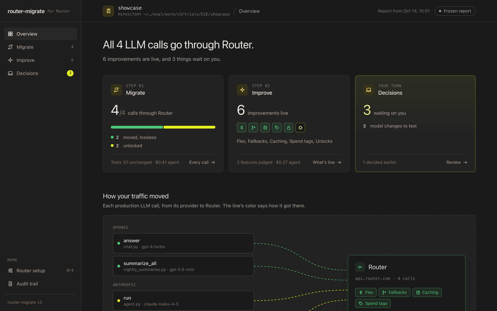
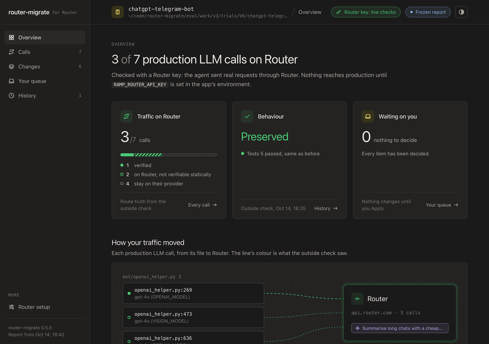

# How router-migrate got here

Every version of router-migrate tested one hypothesis about how to move a codebase onto Router safely, and later how to
make the most of Router once it's there. Each one kept what the evidence supported and dropped what it didn't. This
page is that history: what we believed, how we tested it, what we found, and what changed as a result.

The two questions behind every experiment:

1. **Does the traffic really move, and does the app still behave the same?** Counted as valid requests Router accepts,
   and as tests and typecheck against the baseline. Not as "a client got wrapped".
2. **Is the review worth acting on?** Would a CTO who knows Router act on these recommendations, and are they correct?

## Timeline

| Version | We believed | We tested | We found | So we |
|---|---|---|---|---|
| **v1** | Migration is mostly mechanical: scan, plan, rewrite. | Deterministic pipeline on 15 pinned repos. | The runtime design works (inert by default, per-request fallback, 0 of 15 repos broken). The planner doesn't: rules that make judgment calls overfit, precision falling from 89% to 30% as repos varied. | Kept the runtime. Stopped encoding judgment as rules. |
| **v2** | Router's levers (Flex, fallbacks, caching, spend tags) can be recommended from code signals. | Recommendation cards and a compiled per-feature policy. | The policy mechanism works; the signals don't (latency guessed from file names was often wrong). | Kept the policy file. Moved judgment to an agent. |
| **v3** | An agent with tools that compute facts beats an agent with instructions. | Ablations on 10 fresh repos: rules only, Router's docs prompt, a detailed prompt with all our rules, agent + tools. | Tools removed wrong moves (10 correct, 0 wrong vs 10 / 16 for the docs prompt). Writing our rules into the prompt didn't help (10 / 7). | Made fact-computing tools the core. |
| **v4** | Migrate by default and make the agent prove every move. | Per-item claims, proofs and a gate loop. | Most traffic moved (21 of 51, 0 wrong, 0 broken) but slowly: 229 min, $24.69. Found a real production crash every earlier version had shipped (`deepcopy` of the LlamaIndex client). | Kept migrate-by-default. Questioned the process. |
| **D3** | The process, not the checking, was the cost. | Facts + optional tools + one outside check, no per-item proof. | Same judgment and safety at about 3x the speed and 40% of the cost: 0 wrong, 0 broken, 0 destructive edits. Held-out: 23 of 45 movable calls moved. | Replaced obligations with one outside check the agent can't influence. |
| **v5** | Run it in the user's own Claude Code session and let the agent propose improvements. | A real repo end to end. | Migration worked; the improvement step found nothing. Code was still deciding what counted as an improvement, and the model sat in config behind a wrapper the rules couldn't see. | Gave every judgment to the agent. |
| **v6** | The agent should migrate, improve, and later apply and undo what a human approves; code keeps facts, the outside check and the runtime. | Four end-to-end runs with a live Router key. | Works end to end, including agent-run apply and undo. But few improvements: about 1.7 per repo, mostly model and cache tweaks. | Started the overnight experiments below. |
| **v7** | The review is the product and the migration is the gate. A short prompt with a wide mandate beats a long one with rules. | Seven rounds of blind head-to-head experiments (below), then a held-out check. | Every cut to procedure helped; every cut to facts or tools hurt; widening the mandate produced CTO-level recommendations; it held on repos never used for tuning (5-0). | Shipped the 15-line prompt, the v7 item model, measured numbers on every recommendation and the release gate. |

## v1 to v5: getting the traffic over safely

Five findings shaped everything after them:

- **Wrapped is not moved.** A client can be wrapped and still never reach Router (AI-Scientist's `seed=0`, a base URL
  from config). We count requests Router accepts, per call: verified, unverified, or stays.
- **Tests don't catch destructive edits.** Following Router's public docs prompt, an agent deleted gpt-cli's Azure
  provider and key config; its 14 tests passed before and after. Only a check that knows what must survive catches it.
- **Tools beat prompts for facts.** Every arm that could ask "does Router accept this request?" made zero wrong moves.
- **Process was the cost, not verification.** Dropping per-item proofs kept the judgment and tripled the speed.
- **Real bugs hide behind "tests pass".** The sec-insights `deepcopy` crash shipped in every version until an agent ran
  the app's real path with Router on.

Numbers, ablations and how to reproduce them: [EVAL.md](EVAL.md).

## The overnight experiments: is less more?

v6 worked but its review was shallow. The hypothesis was that the scaffold was boxing the agent in: a 150-line prompt
full of procedure, and a mandate that read as "tune the LLM calls". So we ran rounds of arms (a prompt plus switches
that remove parts of the harness) on the same repositories, headless, and judged them blind.

**How we judged.** First a 1-10 score from a fresh Claude reviewer who sees the report, the outside check and the diffs
but not which arm produced them. Every arm scored about 8, so the score couldn't tell them apart. We switched to a
pairwise judge: two runs on the same repo, order randomised, arms hidden, "which would you rather ship and act on?",
under two rubrics (the original, and a CTO-redesign bar). Runs cut off by an outage or a spent quota are excluded. One
run per arm and repo, so a single win is a signal, not proof; the chain below held across rounds.

| # | Hypothesis | Experiment | Evidence | Verdict |
|---|---|---|---|---|
| H1 | Less procedure gives better work. | v6's 150-line prompt vs a 55-line CTO prompt (lean) vs a 25-line one. | lean 8.0, v6 7.3; improvements per repo 6.0 vs 1.7, same migration coverage. | Yes. |
| H2 | Even less is better still. | lean vs a 10-line prompt (ultra), 5 repos. | ultra won 5-0: more live verification, fewer wrong claims (it caught that lean's headline cache change did nothing). But it built every idea: half as many, twice the cost. | Yes, with a cost. |
| H3 | One line restores breadth: rank by level, build what you're sure of, propose the rest. | ultra vs ultra + that line. | 4-1 on both rubrics, 7.8 recommendations vs 5.0, and cheaper ($12.8 vs $15.2): proposing costs less than building. | Yes. |
| H4 | The agent was fenced. Give it the whole product and every Router surface, nothing out of scope. | ultra + levels vs the open-scope prompt. | 5-0 on both rubrics. The judge's reason every time: it "attacks calls rather than configuring them": deleting an inner agent, collapsing a two-level agent so answers stream sooner, shadow models, Switchyard, Jev considered and rejected with a reason. | Yes: the biggest single gain. |
| H5 | Facts are scaffolding we can cut. | Remove the fact sheet; remove the scanner's map of calls. | No fact sheet lost 1-4 (worst arm in two rounds); no map lost 2-3 and missed a whole call path. | No: facts earn their place. |
| H6 | Tools are scaffolding we can cut. | Remove `policy`, `levers`, or every tool but `check`. | No `policy` lost 0-3; no `levers` lost its pair; with only `check`, agents rebuilt the runtime by hand. `unwrap` was never used by a migrating agent. | No, except `unwrap` (removed from the migrate agent). |
| H7 | A fuller fact sheet (Jev, Switchyard, shadow models, Decisions) drives the wider review. | Open prompt with the full sheet vs the short one; old prompt with the full sheet. | Open prompt: a tie (2-3, 3-2). Old prompt with the full sheet: lost 1-4. The mandate drives the gain, not the extra facts. | No: kept the short sheet. |
| H8 | It generalises. | Open prompt vs the shipped v6 prompt on five repos never used for tuning. | 5-0 on both rubrics. | Yes: shipped as the default. |
| H9 | The approve-then-build loop works for proposals. | An apply session given an approved, never-built rework ("collapse the two-level agent"). | Built it from the description, avoided merging an unapproved dependency, outside check passed. | Yes. |

The rule that came out of it: **cut procedure, keep facts and tools, widen the mandate.**

Full round-by-round log: [eval/lean/LOG.md](../eval/lean/LOG.md). Release gate: [eval/gate/](../eval/gate/).

## What v7 changed because of it

- **The prompt** is 15 lines: the goal, the mandate (the whole product, nothing out of scope), levels, build-or-propose,
  hard rules. Everything else is facts the agent can look up.
- **The report** has four kinds of item. A recommendation says how big it is (quick win, change, rework), who carries it
  out (code, a Router setting, your call), its rank, and what was measured on real Router, with the sample size.
- **The writing** follows a short guide modelled on Anthropic's and Ramp's engineering posts: plain words, the point
  first, terms explained once, numbers with units and what they are per.
- **Router settings** are the human's step on the dashboard; they never go to an agent session.
- **The fact sheet** can re-measure itself on real Router (`router-migrate facts --refresh`).
- **The release gate** (`eval/gate/gate.py`) runs any change to the prompt, facts or tools against the current default
  on working and held-out repos, and only ships a change that wins or ties head-to-head without moving less traffic.

## The dashboard over time

| Version | What it got right | What it got wrong |
|---|---|---|
| v4 | One sentence that says where things stand; step cards; the code change next to what each request to Router looks like. | Built for migration only; improvement cards came from rules. |
| v6 | One item model for everything; Apply hands the human's whole list to an agent. | Denser and harder to read; the review was buried under the migration. |
| v7 | The v4 design inside the Router console's visual language; one job per page; the review first, the migration as the gate; measured numbers on every recommendation. | |

*v4: the design the current dashboard returns to.*

*v6: everything in one item model, but dense.*

## What never changed

- **The runtime.** In production, each request goes to Router when Router can serve it and to the original provider
  otherwise. Without `RAMP_ROUTER_API_KEY` it does nothing; `ROUTER_MIGRATE_DISABLE=1` turns it off.
- **The outside check.** Parse, typecheck and tests against the baseline with Router on, existing tests unchanged,
  Router accepts the requests, route truth per call. The agent can't influence it.
- **Git as the record.** One commit per decision; every decision can be undone.
